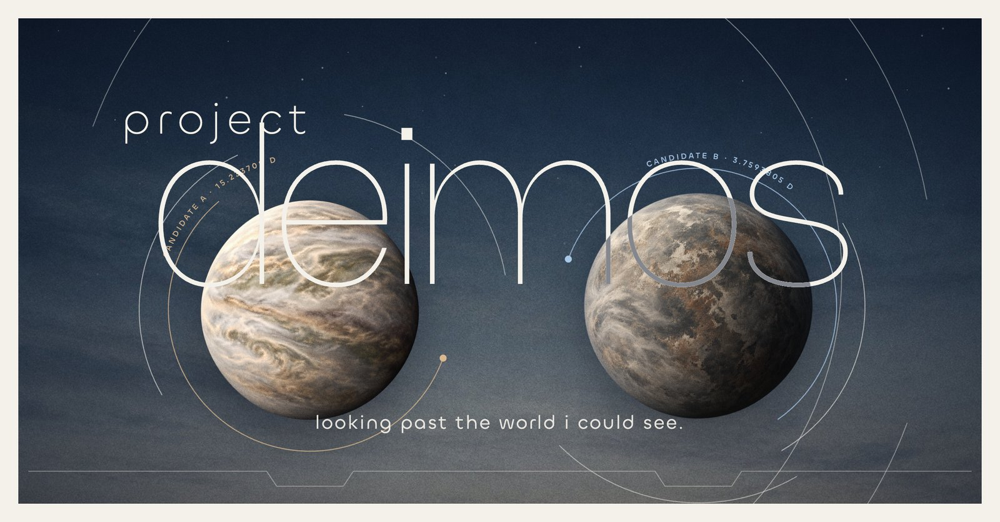
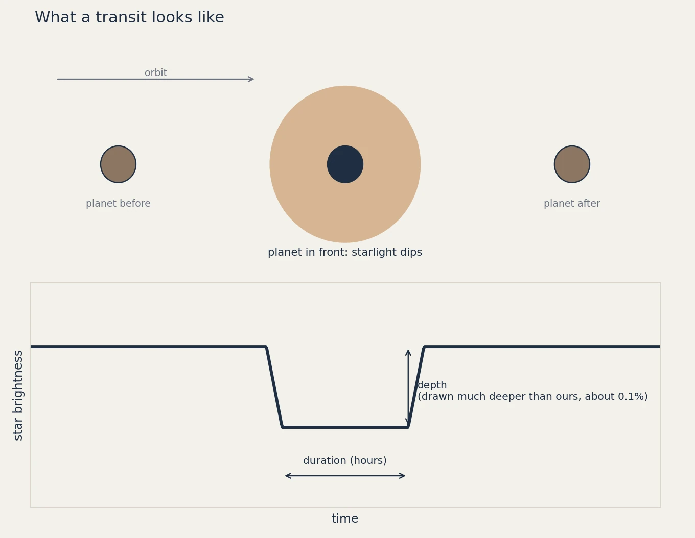
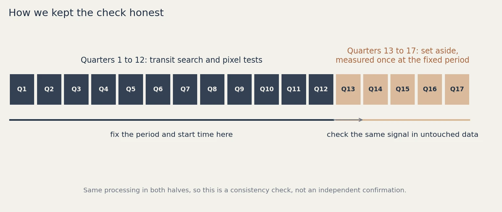
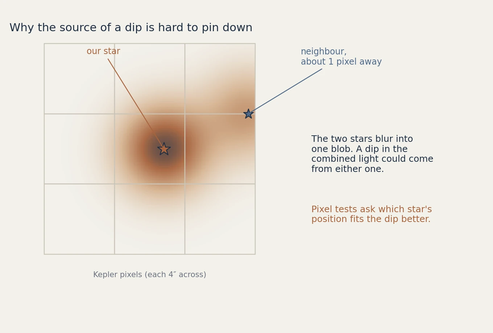

# Project Deimos



*A search for planets in Kepler data. Led by Claude Code, owned and directed by Luca Novac. The planets in the picture are artist's impressions.*

I found exoplanet candidates in NASA's Kepler data at 20, with no astronomy background. Project Deimos searched 50,480 Kepler light curves and came back with three: KIC 10528996, KIC 4916729 and KIC 10976416. Each one is a dip that repeats on schedule, survived every control I threw at it, and showed up again in data the search was never allowed to see. Two are signals I found in stars almost nobody had searched. The third (KIC 10976416) was catalogued years ago as a false positive on a giant star, and my pixel test puts it on a different star, where it would be a planet about twice the size of Earth. They are candidates, not confirmed planets. Confirmation takes follow-up observations, and the evidence is all here for anyone who wants to do it. The write-up is at [nluca.space/deimos](https://nluca.space/deimos).

A planet passing in front of its star dims the star slightly, over and over. Finding that dip in noisy data is the whole job. Everything in this repo is what I used: the code, the per-batch results, and the evidence for each star.



## Who did what

This is my project. I started it, decided where to look, set the rules and made the calls on every lead. The repo and the results are mine.

The pipeline is Claude Code's work. Claude Code is Anthropic's AI coding agent, and it led the engineering: it designed and wrote the search, the controls, the pixel test, the catalogue check and the tests, and it ran the batches. I did not write this code by hand. My part was prompting and checking results.

I study business analytics and have no astronomy background. There was no team and no lab. Since I could not judge the astronomy by eye, nothing counted until it passed checks:

- Controls in every batch: the light curve flipped upside down, the light curve cut into blocks and shuffled, and the light curve with a fake planet added. Anything the controls also produce is noise.
- Fake planets injected at known periods and depths, to measure how many the pipeline can actually find.
- Tests on the code, and regression hashes so a refactor can't silently change a result.
- Decision rules written down before I saw any results, and a held-back slice of data opened once per signal.

## How it works

Kepler watched about 150,000 stars for four years. The Kepler Bonus background light curves, from the NASA Kepler mission and hosted on the MAST archive, cover fainter stars in the background of those images. Few people had searched them, so that is where I looked.

For each star:

1. Split the data. The first 75% of the observing quarters is for searching. The last 25% is locked away.
2. Search four versions of the searchable data for repeating box-shaped dips (periods from 0.5 to 30 days): the real light curve, the flipped one, the shuffled one, and the real one with a fake planet added.
3. Screen the peaks. A signal has to pass automatic checks that the controls mostly fail: odd and even dips equal in depth, no secondary eclipse, no smooth variability, no red noise.
4. Open the held-back data once. For signals that survive, I look at the locked 25% at the exact period and timing found earlier, with no refitting. If the dip is not there, the signal is out.
5. Follow up the survivors. A pixel test works out which star in the image the dip comes from, since Kepler pixels are large and a nearby eclipsing binary can imitate a planet. A catalogue check compares each signal against known planets, candidates, eclipsing binaries and variable stars.





The full method is in [docs/method.md](docs/method.md).

## Results

| Star | Period | Depth in search | Depth in held-back data | Size if real | Where it stands |
|---|---|---|---|---|---|
| [KIC 10528996](data/candidates/KIC10528996/README.md) | 13.7448 d | 475 ppm | 528 +/- 20 ppm | 2.7 to 2.9 Earth radii | Repeats in held-back data. Pixel test favors the target star. Catalogue check incomplete. |
| [KIC 4916729](data/candidates/KIC4916729/README.md) | 15.2337 d | 984 ppm | 1157 +/- 116 ppm | 2.2 to 4.3 Earth radii | Repeats in held-back data. No match in the catalogues I checked. |
| [KIC 10976416](data/candidates/KIC10976416/README.md) | 3.7594 d | 898 ppm | 900 +/- 24 ppm | about 1.9 to 2.0 Earth radii | Already catalogued as K07393.01. The pixel test puts it on KIC 10976416, not the giant star it was catalogued on. |
| KIC 9520080 | 2.3770 d | 1578 ppm | 1509 +/- 118 ppm | none stated | Withheld. A faint star 3.5 arcsec away could be the true source and I could not rule it out. |

Sizes assume the target is the host star and the dip is not diluted by a neighbor. The held-back data comes from the same telescope and processing as the rest, so a repeat there shows the signal is stable, not that it is a planet. The numbers come from [data/candidates.csv](data/candidates.csv).

## What's in the repo

```
deimos/                 the pipeline (pip install . from this folder)
  adapter.py            reads and checks the Kepler Bonus files
  science.py            builds the four versions of each light curve
  core.py               cleaning, search, screening, data split
  search.py             search plug-ins
  fastbls.py            fast C version of the period search, same results
  source.py             runs one star through every version
  coordinator.py        runs a batch of stars in parallel, resumable
  stages.py             opens the held-back data once, with a ledger
  report.py, cli.py     reports and the command line
  manifest.py, inputs.py, util.py    batch settings, file lookup and download, helpers
  pixel.py              which star does the dip come from
  catalogue.py          is the signal already known
  frozen-pins.json      checksums of the pinned numerical files
  science-config.json   the frozen search settings
data/
  candidates.csv        one row per star above, with the numbers
  candidates/<KIC>/     short page and figures for each star
  batches/<B>/          summary.json, REPORT.md and ranked leads for each batch
  registrations/        the 63,610 stars selected for batches (50,480 completed), with Kepler file links and checksums
  archives.csv          release archives of the full per-star results, with sizes and checksums
docs/method.md          the method in detail
docs/images/            the pictures on this page
examples/               a two-star example batch
scripts/                regression check
tests/
```

The full per-star results (every peak from every version of every light curve, about 19 GB) are release archives on this repo's Releases page, listed in `data/archives.csv`. B4a and B4b share one 8 GB file, uploaded in parts. I did not re-host the raw Kepler files. The registration files in `data/registrations/` hold their download links and checksums.

## Run it

You need Python 3.10 or newer and about 10 MB of disk per star.

```bash
pip install .
python -m deimos fetch examples/kepler-minimal/batch.json     # downloads 2 example stars from MAST
python -m deimos run examples/kepler-minimal/batch.json       # a minute or two
python -m deimos report examples/kepler-minimal/batch.json    # REPORT.md and ranked leads
```

The other commands are `validate`, `status` and `verify-pins`; `python -m deimos --help` lists them. To search new stars, write a `registration.csv` with one row per star (copy the columns from the example) and point a `batch.json` at it. The registration files list the 63,610 stars I selected for batches. 50,480 were completed and the rest failed or never ran, so check the batch results before skipping one. For the fast C search you need a C compiler and this line in `batch.json`: `"search_plugin": "deimos.fastbls:exact_select"`.

If a run is interrupted, the unfinished stars are marked and never re-run, so no result is computed twice. To redo them, use a fresh output folder.

### Where I ran it

I ran the full batches on a rented cloud server, because I did not want my laptop working flat out for days. Nothing in the pipeline needs the cloud. It is plain Python, it reads files from local disk, and the example above runs on a laptop. A big batch on your own machine just takes longer: set `workers` in `batch.json` to the number of cores you can spare, and a stopped run resumes with the stars it had not started.

### Follow-up steps

On a finished batch folder:

```bash
python -m deimos.catalogue BATCH_DIR --out queue.csv --cache catalogue-cache
python -m deimos.pixel LEADS_CSV --out pixel-out [RANK ...]
```

The pixel step needs an extra install: `pip install ".[pixel]"`.

To check that your install gives my numbers:

```bash
python scripts/regression_compare.py --check-expected docs/expected-example.json --new-out DIR
```

It matches 8 of 8 on the Mac it was made on. On Linux 7 of 8 is normal: one result differs in the last bits of a float.

## What didn't work

- The pipeline misses many fake planets. In batch B3b, 1,874 of 4,689 injected planets made it through. 1,603 never appeared among the top five peaks. 951 were found and then screened out, and the smooth-variability rule was involved in 866 of those. It protects against false positives but it is blunt. My replacement passed its written acceptance test on batch B3c: 109 more injected planets recovered at the same number of control survivors (95% interval +48 to +167), with no known planet lost. But 42 of 46 groups of stars overlapped the batch I developed it on, so that was not an independent test, and I never adopted it.
- I never got a working transit-shape fit. Both versions of my shape and density check failed validation, so I can't say whether any candidate has the right shape for a planet around its star.
- There is no TESS cross-check. I never got the data access sorted out.
- The held-back data is not independent of the rest. Passing it shows a signal repeats, not that it is astrophysical.
- Ranking leads with an AI model did not beat sorting by signal strength in a blind test, so it never made a decision.

## License and contact

MIT license, see [LICENSE](LICENSE). If you work on exoplanets and want to look at these signals, or you find something with this code, I would like to hear from you: [nluca.space](https://nluca.space). If you spot a mistake in the code or the method, open an issue.
