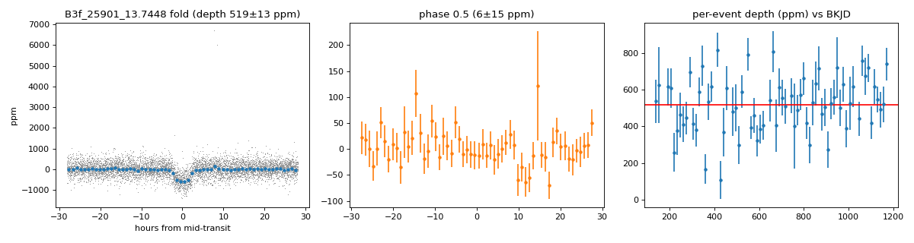

# KIC 10528996

An unconfirmed candidate signal. It is not a confirmed or validated planet, and I do not claim it is new.

## The signal

- Period 13.744751 d, first dip at 139.139731 BKJD (BJD_TDB - 2454833). Both are the values the search found, with no refit and no uncertainty, so do not use them to predict transit times.
- Duration 4.68 h (0.195 d). This is a search-grid value, not a fit.
- Depth 475 ppm in the search, which saw it in 12 of 12 discovery quarters. Folding the light curve over Q1 to Q12 gives 513 to 519 ppm (519 +/- 13 ppm).
- Held-back data (Kepler quarters 13 to 17): 528 +/- 20 ppm, SNR 26.0, 1.11 times the discovery depth, at the same period and timing with no refit. It is the same telescope and processing, so this shows the dip repeats, not that it is independent confirmation.
- Odd and even dips agree to between 0.5 and 1.86 sigma, depending on the estimator.
- Size: 2.7 to 2.9 Earth radii, only if KIC 10528996 is the host and the dip is undiluted (Teff 5669 K, star radius 1.14 to 1.17 solar). At most 4.6 Earth radii if neighbors dilute it as much as they could.

## Checks it passed

- The pixel test assigned the dip to the target star in 9 of 11 fitted quarters (Q1 could not be tested). A stricter version of the gate passes 4 of 12 quarters. A second test of depth by star gives the target z = 18.4. Fake dips injected as controls were recovered in 11 of 11 fitted quarters, using a synthetic pixel response only.
- No match within 65 arcsec in the confirmed-planet, TOI, KOI and Kepler DR24 and DR25 TCE tables.

## Still open

- A catalogue of community follow-up observations and the literature were not searched, so I cannot say it is new.
- An eclipsing binary within about 1 to 2 arcsec, or fainter than the Gaia limit, is not excluded. Kepler pixels are about 4 arcsec across.
- A G 18.8 source at 21.6 arcsec is outside the pixel model, and Q1 is untested.
- The transit shape and star density are unmeasured, because I never had a working fitter.
- What would help: high-resolution imaging from 0.1 to 2 arcsec down to a magnitude difference of about 7.4, and a spectrum to get the star's density.

## Figure

[`lightcurve.png`](lightcurve.png) is the light curve folded at the period, over the discovery quarters Q1 to Q12. Per-quarter pixel results are in [`pixel-summary.json`](pixel-summary.json), and the full record is in [`candidate.json`](candidate.json).

