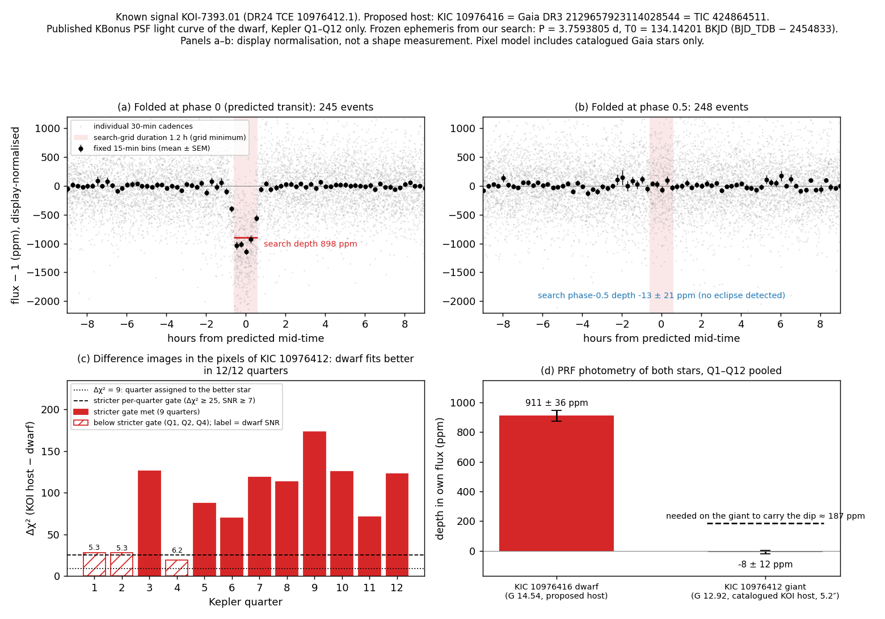
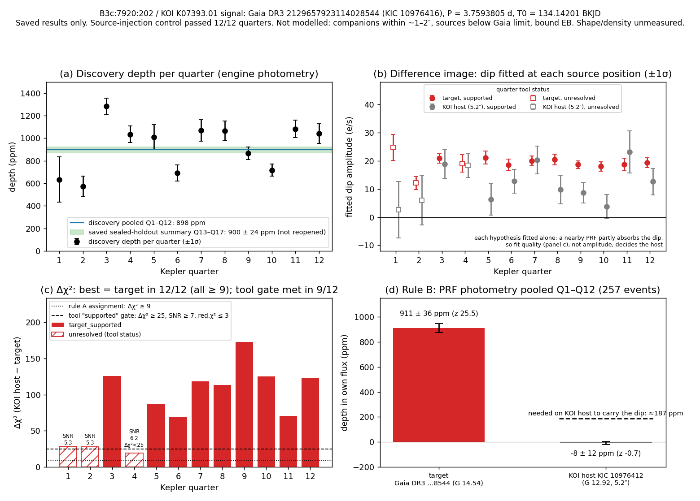

# KIC 10976416

A known signal, KOI K07393.01, with a proposed new host star. It is not a confirmed or validated planet, and I do not claim it is new.

## The signal

- The catalogue lists K07393.01 as a centroid-offset false positive on the giant KIC 10976412. My pixel test puts the dip on KIC 10976416, a dwarf star nearby. Whether that attribution is already published is unconfirmed.
- Period 3.7593805 d, first dip at 134.142013 BKJD (BJD_TDB - 2454833), both search values. A descriptive fit to the discovery quarters gives 3.7593912 +/- 0.0000151 d, which is not checked against the held-back data.
- Duration 1.2 h (0.05 d). This is the minimum of the search grid, not a fit.
- Depth 898 ppm in the search (SNR 52.9, 12 of 12 quarters).
- Held-back data (Kepler quarters 13 to 17): 900 +/- 24 ppm, SNR 37.8, 1.00 times the discovery depth, at the same period and timing with no refit. Same telescope and processing, so this shows the dip repeats, not that it is independent confirmation.
- At phase 0.5 the signal is -13 +/- 21 ppm.
- Size: about 1.9 to 2.0 Earth radii, only if the dwarf KIC 10976416 is the host (star radius 0.58 to 0.61 solar).

## Checks it passed

- The pixel test assigned the dip to the dwarf in 12 of 12 quarters (9 of them with the stricter gate). A second test of depth by star gives z = 25.5 for the dwarf and z = -0.69 for the catalogued giant. Fake dips injected as controls were recovered in 12 of 12 quarters.

## Still open

- A blend within 1 to 2 arcsec (down to a magnitude difference of 7.6) and an eclipsing binary at twice the period are not excluded.
- Faint sources at 12 to 14 arcsec are outside the pixel model, and the star radius could be wrong.
- The transit shape is unmeasured, because I never had a working fitter.
- What would help: infrared high-resolution imaging from 0.1 to 3 arcsec, then a spectrum and a false-positive probability.

## Figures

[`lightcurve.png`](lightcurve.png) has four panels: (a) the fold, 245 events; (b) the phase 0.5 check, 248 events, -13 +/- 21 ppm; (c) the pixel test's chi-squared gain per quarter; (d) the depth-by-star test, 911 +/- 36 ppm against -8 +/- 12 ppm.

[`diagnostics.png`](diagnostics.png) shows the search depth per quarter with the pooled discovery depth and the held-back band (900 +/- 24 ppm) on one axis. The band is a saved summary of quarters 13 to 17, overlaid on discovery values, so the two are not measured the same way.

Per-quarter pixel results are in [`pixel-summary.json`](pixel-summary.json), and the full record is in [`candidate.json`](candidate.json).
