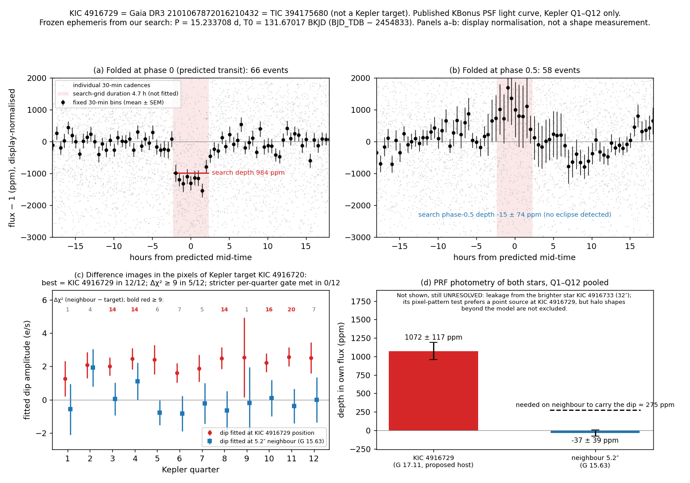

# KIC 4916729

An exoplanet candidate: a 15.2-day dip that repeats in the held-back data and matches nothing in the catalogues I checked. It is not yet confirmed as a planet, and a clean catalogue check is not proof that it is new.

## The signal

- Period 15.233708 d, first dip at 131.670165 BKJD (BJD_TDB - 2454833). Both are the search values, with no refit.
- Duration 4.7 h (0.195 d). This is a search-grid value, not a fit.
- Depth 984 ppm in the search (SNR 13.6), with quarter depths from 912 to 1419 ppm.
- Held-back data (Kepler quarters 13 to 17): 1157 +/- 116 ppm, SNR 10.0, 1.18 times the discovery depth, at the same period and timing with no refit. Same telescope and processing, so this shows the dip repeats, not that it is independent confirmation.
- At phase 0.5 the search measured -15 +/- 74 ppm. Odd and even dips agree within 0.07 sigma.
- Size: 2.2 to 4.3 Earth radii, only if KIC 4916729 is the host (star radius from 0.64 to 1.15 solar, depth 984 to 1157 ppm).

## Checks it passed

- The pixel test prefers the target over a neighbor 5.2 arcsec away: it assigned the dip to the target in 5 of 5 assigned quarters, and a second test of depth by star gives 1072 +/- 117 ppm for the target against -37 +/- 39 ppm for the neighbor.
- No period match among 46,472 KOI, DR25 TCE and Kepler eclipsing binary catalogue entries.

## Still open

- The brighter KIC 4916733, 32 arcsec away, is unresolved as a possible source. Leakage of its light into the target's pixels is not ruled out (controls 6 of 6).
- A blend within 1 to 2 arcsec is not excluded. Neither is an eclipsing binary with equal dips at twice the period (30.47 d).
- Non-KOI DR24 TCEs and the literature were not checked, so novelty is unproven.
- The transit shape and star density are unmeasured, because I never had a working fitter.
- What would help: a far-wing calibration of the pixel response or resolved photometry during transit, imaging below 2 arcsec, and a spectrum.

## Figure

[`lightcurve.png`](lightcurve.png) has four panels: (a) the fold, 66 events; (b) the phase 0.5 check, 58 events; (c) the pixel test's chi-squared gain per quarter; (d) the depth-by-star test, 1072 +/- 117 against -37 +/- 39 ppm.

Panel (b) uses a display normalisation and shows an apparent brightening of about +0.7 to 1.5 ppt near phase 0.5, while the search measured -15 +/- 74 ppm there. Do not read panel (b) as proof of no secondary eclipse.

Per-quarter pixel results are in [`pixel-summary.json`](pixel-summary.json), and the full record is in [`candidate.json`](candidate.json).

